# RepoPrompt CE live performance profile (2026-10-12)

Target: the running macOS app, PID 13579, `/Applications/RepoPrompt CE.app`, uptime about 3 h. Window 3 (`repoprompt-ce`) was driven through the read-only MCP CLI.

Method: every scenario below was recorded with the **Tern native profiler** (1 ms sampling, 20 s window, idle samples hidden). A screenshot was taken per claim with `tern ctl shot`. Numbers were transcribed from those screenshots and cross-checked against `tern ctl state`. Raw `sample`, `heap`, `footprint` and `vmmap` captures from the subagents are supporting evidence only. Screenshots are in `shots/`, per-shot transcriptions in `data/evidence_numbers/*.json`, per-scenario metadata and per-call latencies in `data/evidence.jsonl`, and the six research reports in `subreports/`.

## 0. How to read the numbers

- Every percentage is a share of **non-idle samples across all threads**, not of wall time. Tern hides idle samples, so the per-scenario total below is the denominator.
- "total" means inclusive. "self" means leaf time. A sample is about 1 ms of one thread.
- Idle baseline: 312 non-idle samples against 154,441 hidden idle samples in 20 s. That is **99.8% idle, about 1.6% of one core summed over all threads**.
- Load scenarios used about 15 s of back-to-back CLI calls each. The CLI opens a new connection per call, so connection-setup costs are over-represented compared with a persistent MCP client.

| Scenario | Non-idle samples | Hidden idle | Calls | Median | p-max |
|---|---|---|---|---|---|
| idle | 312 | 154,441 | 0 | n/a | n/a |
| a get_file_tree (full) | 7,744 | 137,231 | 83 | 0.164 s | 0.690 s |
| b file_search content regex | 14,186 | 173,265 | 46 | 0.276 s | 0.722 s |
| c file_search path glob | 18,780 | 209,976 | 86 | 0.170 s | 0.557 s |
| d read_file x5 (0.6 to 1.1 MB each) | 5,156 | 135,596 | 39 | 0.379 s | 0.925 s |
| e get_code_structure dir (signatures) | 5,654 | 162,388 | 2 | **10.96 s** | 11.20 s |
| e' get_code_structure dir, `signatures:false` | 6,995 | 137,208 | 61 | 0.190 s | 0.547 s |
| f workspace_context | 9,101 | 138,003 | 109 | 0.131 s | 0.516 s |
| g git status/diff/log | 4,552 | 133,313 | 51 | 0.255 s | 0.857 s |

Latencies include CLI process spawn plus connect, about 0.12 to 0.15 s of baseline.

## 1. Verdict table (claim, Tern proof, status)

"Confirmed" means the Tern profile shows the function with the stated weight. "Not reproduced" means a claim from the `sample` captures did not recur in the Tern run. "Not Tern-verifiable" means a CPU profiler cannot show it.

| # | Claim | Tern proof (shot) | Status |
|---|---|---|---|
| 1 | `get_code_structure` with signatures blocks about 10 s while using almost no CPU. | e: calls take **10.72 to 11.20 s**; e' (`signatures:false`) median **0.19 s**, a 57x difference. `CodeMapRootManifestStore` shows 13.1% (743 samples) in e, with `scanLocked` 2.8% (160) and `openat` 1.1% (60). The same terms match **0** functions in e'. | Confirmed |
| 2 | Idle git polling: `GitService.listWorktrees` plus process spawns. | Idle: `listWorktrees` **18.3% (57 samples)**; `posix_spawn` 5.1% total (16); `__posix_spawn` is the **top bottom-up self frame at 7.4%**. | Confirmed |
| 3 | `parseGitDate` rebuilds a `DateFormatter` per call. | 1.6% (5 samples). The ICU claim is not visible in the table. | Cost confirmed, small. Mechanism is inferred. |
| 4 | Main-thread SwiftUI and CoreAnimation work while idle. | Idle: `NSHostingView.layout` **11.2% (35)**, `CA::Context::commit_transaction` **7.1% (22)**, `collect_animations_` 1.6% (5). | Confirmed |
| 5 | `AgentRotatingTipsView` drives that idle display work. | 1 sample (0.3%) in 20 s. | **Weakly supported.** It is present but not the dominant trigger. |
| 6 | `ProcessTermination.waitForTerminationStatus` polling. | Idle: 2.2% (7 samples). The `__wait4` term matched 0 functions. | Confirmed, small |
| 7 | Main-actor `lstat` in `canonicalPath` on every git tick. | Idle: `canonicalPath` 0.3% (1); `updateGitContextRefreshLoop` 1.0% (3); `lstat` 2.9% self across all threads. | Confirmed, tiny |
| 8 | `SearchLineIndex.init` rebuilt per file per content search. | b: **30.7% total, 29.5% self (4,190 samples)**, the top self frame. | Confirmed, strongest finding |
| 9 | Path search cost is allocation and retain/release churn. | c: `swift_release` 13.9% plus `swift_retain` 11.7% self, `wildmatch` 5.2% self (6.9% total), `Substring` subscript 3.7%. | Confirmed |
| 10 | MCP result `Value` round trip with a `Regex` built per string. | `Regex` is 5.0% (388) in a, 4.8% (440) in f, 3.5% (182) in d. | Confirmed |
| 11 | Large responses are JSON-encoded and decoded repeatedly. | d: `newJSONString` **23.9% total (13.4% self)**, `__CFFromUTF8` 10.2% self, `JSONDecoder` 15.8% (815). | Confirmed |
| 12 | Tool calls trigger a main-thread AttributeGraph storm. | f: `AG::Graph::UpdateStack::update` **7.9% total (720), 7.1% self (650)** on the Main-thread column. AG frames are top bottom-up self rows in a (8.0% + 7.7%), e' (6.6% + 6.2%) and g (10.1% + 9.3%); in d only `propagate_dirty` (5.9%) is in the top four. Idle total is only 312 samples. | Confirmed. The invalidating view is not identified. |
| 13 | `MCPRoutingStateStore.save` per connection, with an 8.3 s stall. | c 1.3% (247), f 4.3% (387). The **8.3 s stall did not recur**: c max 0.557 s. | Cost confirmed. Stall **not reproduced**. |
| 14 | `MCPExternalEventsMonitor.findLatestEventFile` runs per connection. | d: 1.9% (97 samples). | Confirmed, small |
| 15 | Codemap manifest writer rescans the directory, 8,262 samples in the earlier g `sample`. | Not probed in the g run. It shows only in e (item 1). | **Not reproduced in g.** Unverified. |
| 16 | Git cost under load (status, diff, log). | g: `listWorktrees` 0.9% (41), `posix_spawn` 0.2% (9), `parseGitDate` 0.1% (6). The call itself is cheap. | Confirmed cheap |
| 17 | Memory footprint is about 90% malloc heap, mostly decoded code-map manifest records. | Tern shows only RSS in its Processes block (181 to 273 MB) against a `footprint` of 678 MB. That matches about 440 MB swapped/compressed. | **Not Tern-verifiable.** Backed by `footprint`/`heap`/`vmmap` (section 5). |
| 18 | Backend algorithmic issues: transcript O(n²), FSEvents `visitedPaths` scans, `WorkspaceFileContextStore` rebuilds, Claude NDJSON re-parse, worktree codemap whole-file reads. | No workload was exercised that reaches them. | **Unverified (static review only)** |

## 2. Evidence by finding

### 2.1 get_code_structure signatures blocks about 10 s (confirmed)

Tern profile during e: 5,654 non-idle samples in 20 s with **2 calls completed**, each 10.7 to 11.2 s. Wall time is almost entirely a wait, not CPU. The CPU that does show up is the codemap manifest store (13.1% inclusive, 743 samples) with `scanLocked` and `openat` beneath it.

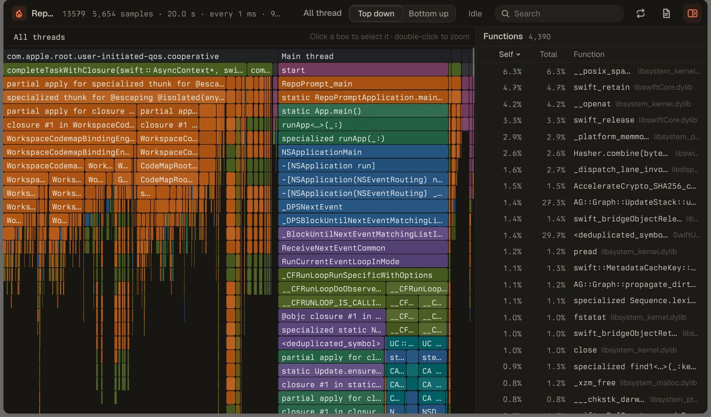
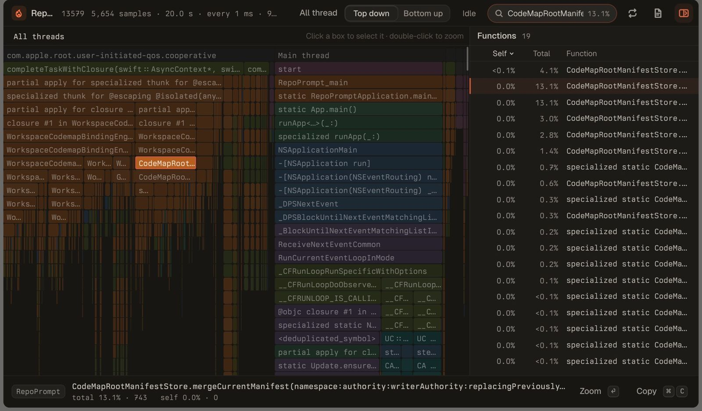
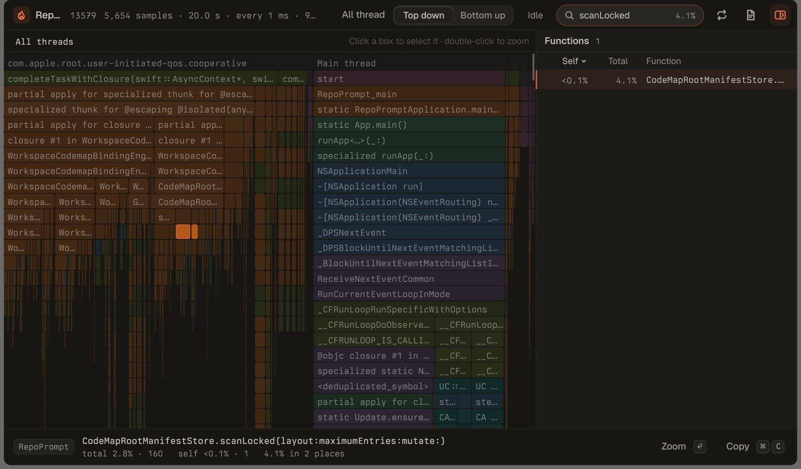
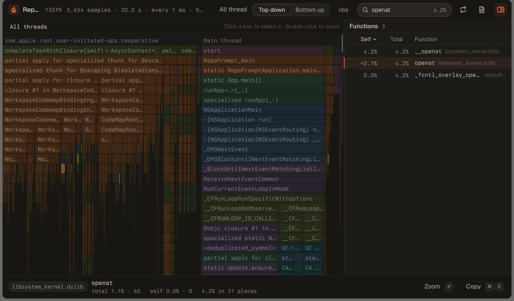
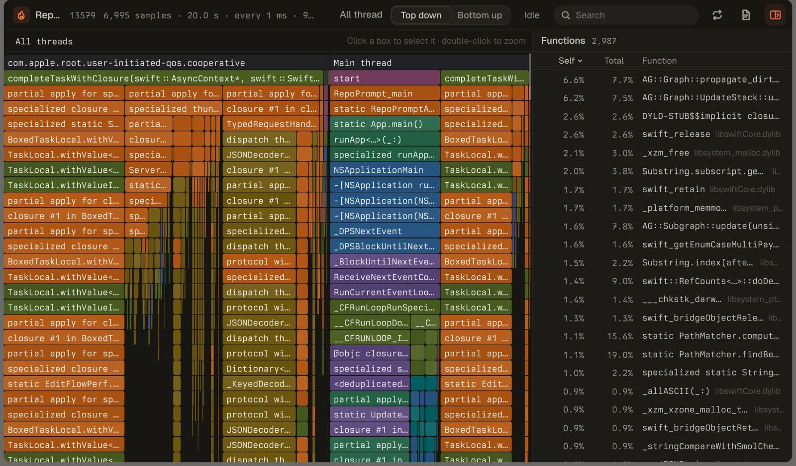

**Root cause.** `workspaceCodemapProductionDemandWaitMilliseconds = 10000` (`WorkspaceCodemapPresentationCoordinator.swift:3`) is used as `maximumTotalWait` at `MCPServerViewModel.swift:6158`. The poll loop backs off 25 to 250 ms until the deadline instead of returning partial results. The output always reads "0 edges, 7 signature files" regardless of directory size. [INFERENCE: seeds never become ready before the deadline.]

**Fix.** Return partial results early, or make demand completion event-driven. Cap the wait below client timeouts. `signatures:false` is the interim workaround.

### 2.2 Idle git polling (confirmed)

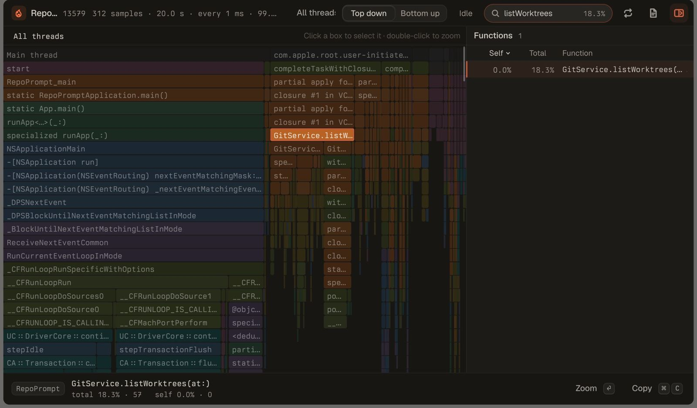
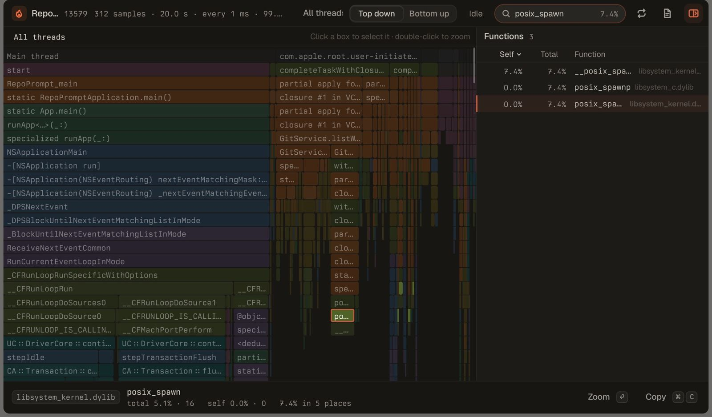
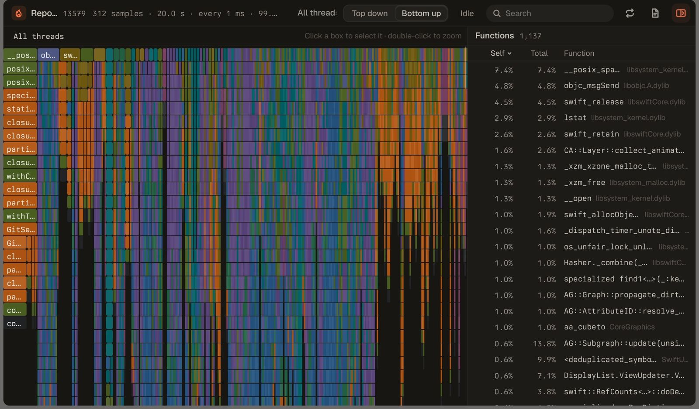
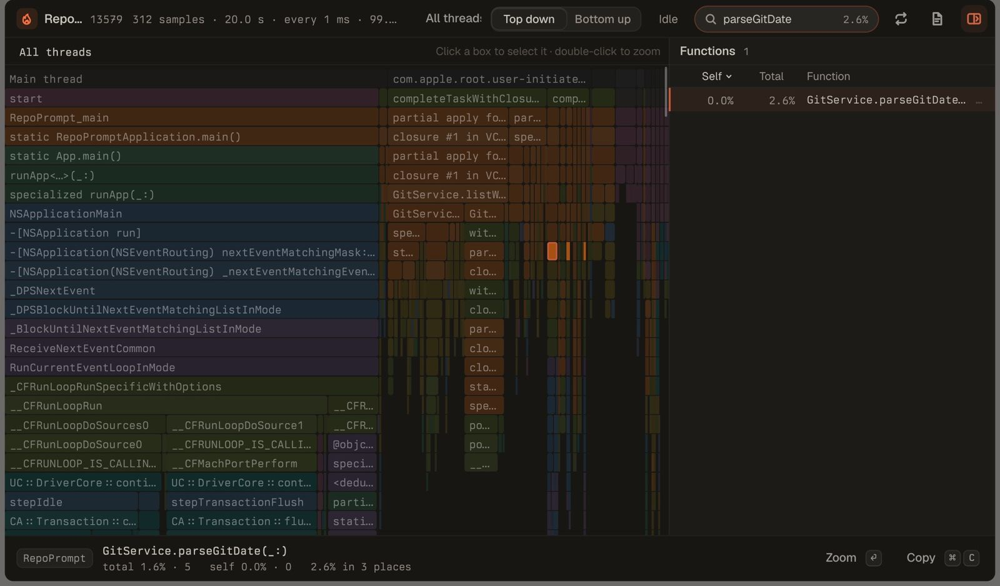
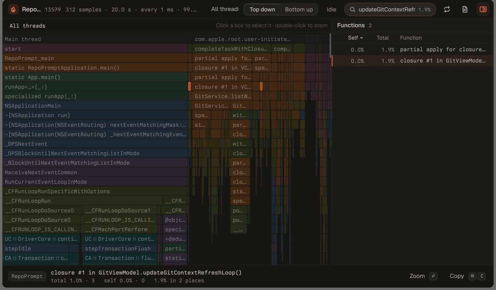
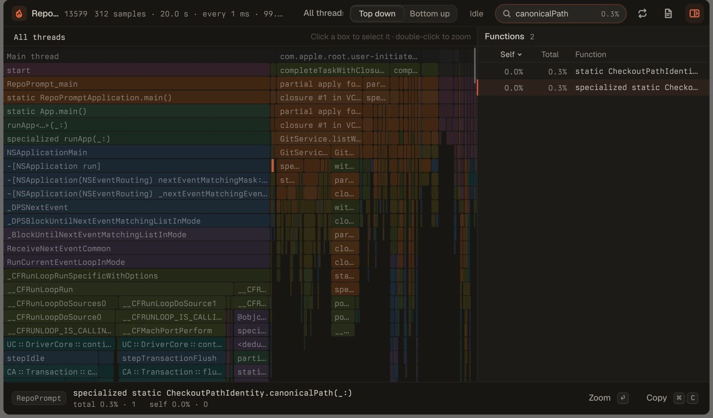

Idle numbers, share of 312 non-idle samples:

| Frame | Share | Samples |
|---|---|---|
| `GitService.listWorktrees(at:)` | 18.3% | 57 |
| `__posix_spawn` (bottom-up self) | 7.4% | n/a |
| `posix_spawn` (inclusive) | 5.1% | 16 |
| `lstat` (self, all threads) | 2.9% | n/a |
| `parseGitDate` | 1.6% | 5 |
| `updateGitContextRefreshLoop` | 1.0% | 3 |
| `canonicalPath` | 0.3% | 1 |

**Root cause.**
- `GitViewModel` refreshes every 2.5 s (`GitViewModel.swift:128, 476-507`). The shared worktree-listing TTL is also 2.5 s (`VCSService+SharedWorktreeListing.swift:12`), so the cache always expires before the next tick.
- Every tick runs `git worktree list`, then `collapseEquivalentWorktreeAliases`, which resolves layout and hashes every worktree. This repo has 25 worktrees.
- `GitStatusActor` adds a 5 s poll of about 7 to 9 git processes (`GitStatusActor.swift:94-97, 521-538`).
- `GitViewModel.apply` republishes about 10 `@Published` properties per poll (`GitViewModel.swift:155-197`). [INFERENCE: this feeds the SwiftUI churn in 2.3.]

**Fix.**
- Key the listing cache on a stat fingerprint of `.git/worktrees`, or drive it from the existing `GitWorkspaceMetadataMonitor`. Keep a 30 to 60 s safety poll.
- Skip the status fan-out when HEAD, index and refs are unchanged.
- Dedupe the snapshot before publishing.
- Pause the loops when the window is not key.
- Canonicalize roots once, off the main actor.

### 2.3 Idle main-thread display cycles (confirmed; trigger only partly attributed)

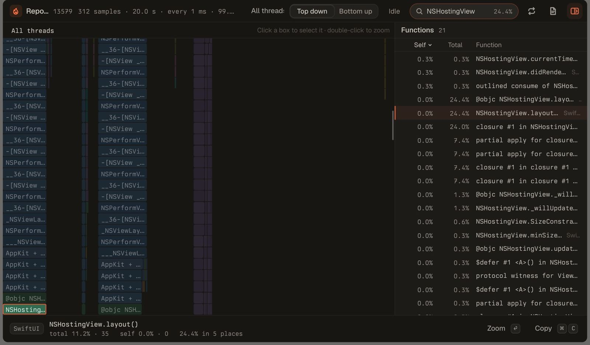
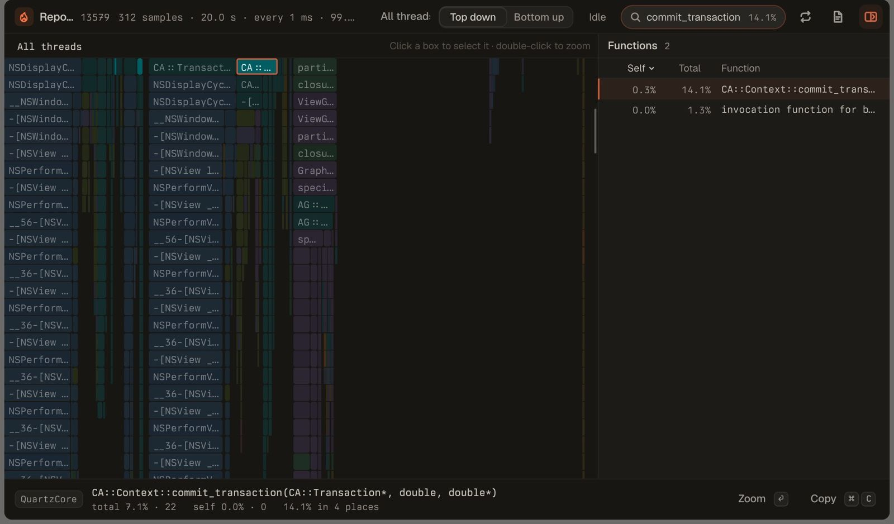
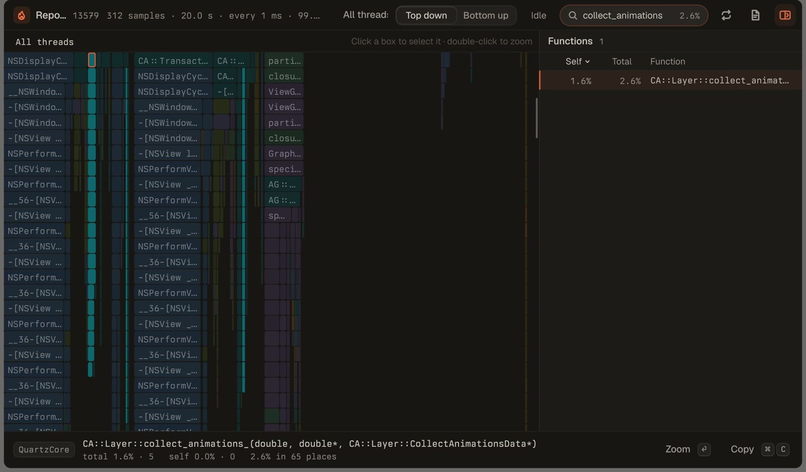
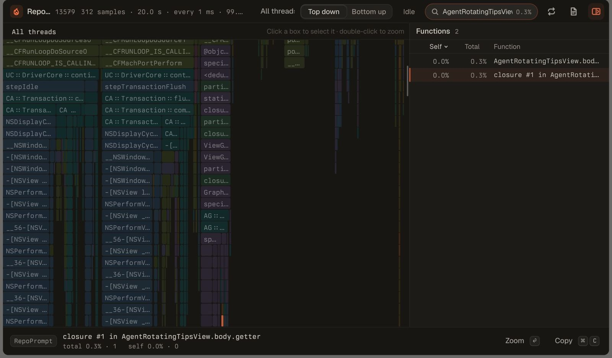

SwiftUI hosting layout and the CA commit are the main app-thread costs while idle. The earlier `sample` captures put 82% of main-thread active samples in `UC::DriverCore::continueProcessing`. Tern shows the same stack.

`AgentRotatingTipsView` was hypothesised as the trigger, with an 8 s animated rotation at `AgentEmptyStateViews.swift:259-357`. In a 20 s Tern window it appears in **one** sample, so it explains little of the cost. Other candidates remain, none measured:
- the always-mounted hidden `ProgressView` (`AgentModeView.swift:3303-3325`);
- `.blur(radius: 0)` on all routed content (`ContentRootShellView.swift:37`);
- the git `@Published` fan-out in 2.2.

**Next step.** A/B test: gate the tips view and the hidden `ProgressView`, then re-record idle and compare the `NSHostingView.layout` and `commit_transaction` shares.

### 2.4 Content search: `SearchLineIndex.init` (confirmed, strongest)

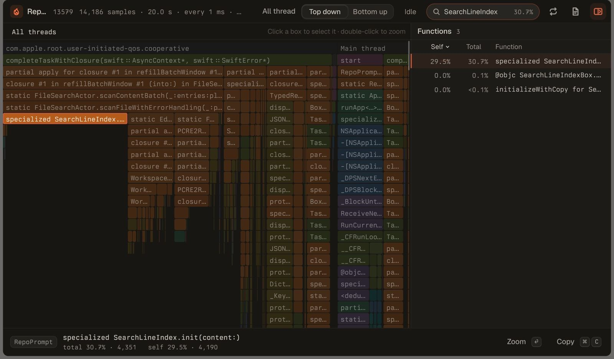
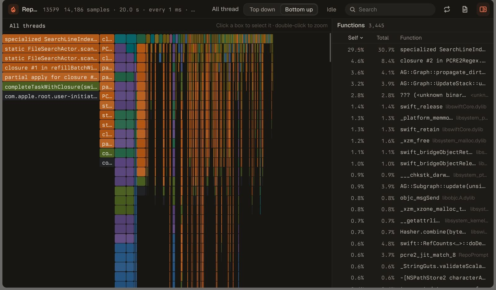
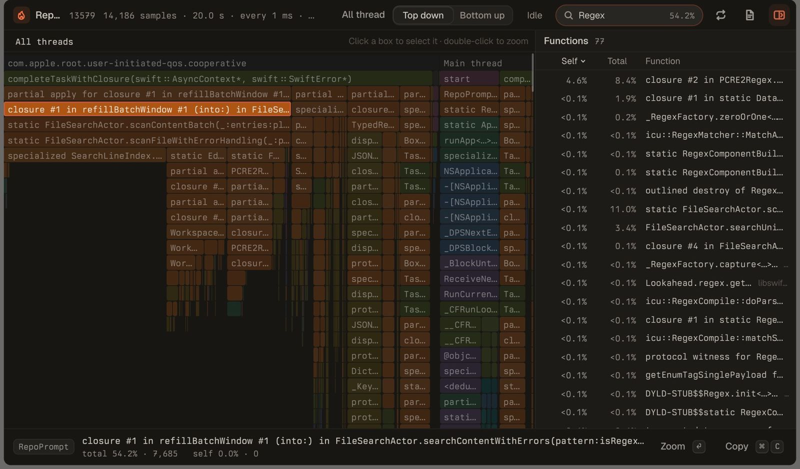

- `SearchLineIndex.init(content:)` is **30.7% total and 29.5% self (4,190 samples)**. It is the top self frame in the profile.
- The whole `FileSearchActor.searchContentWithErrors` batch-refill closure is 54.2% (7,685), so the line index is more than half of the search work.
- PCRE2 matching (`closure #2 in PCRE2Regex…`) is 4.6% self (8.4% total). That cost is legitimate.

**Root cause.** A line index is rebuilt from the full content of every file on every search, with no reuse between calls. The earlier `sample` also showed `retainSliceRebaseSource` / `trimSliceRebaseSourcesIfNeeded` churn per file (540 samples).

**Fix.** Build the index lazily from the already-loaded content only for files that have a match, or cache it keyed by content fingerprint.

### 2.5 Path search: allocation churn (confirmed)

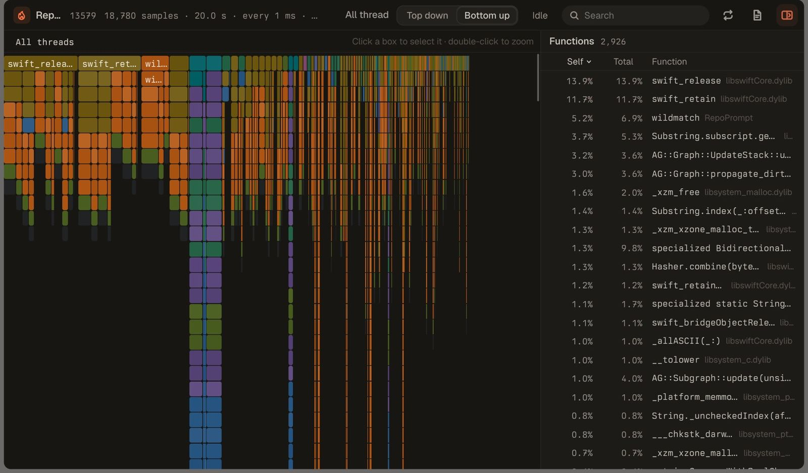
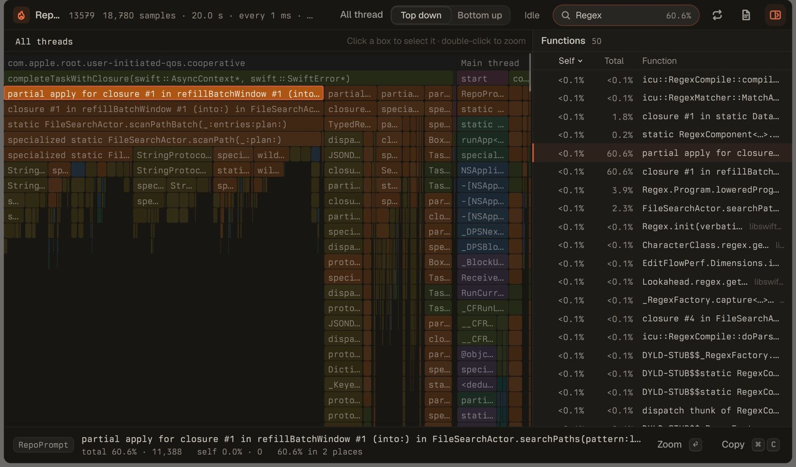

`swift_release` 13.9% self plus `swift_retain` 11.7% self together are about **25.6%** of non-idle samples. `wildmatch` is 5.2% self (6.9% total). `Substring.subscript` is 3.7% self (5.3% total). `FileSearchActor.searchPaths` closures are 60.6% inclusive (11,388).

**Root cause.** The earlier `sample` pointed at `scanPath` → `pathGlobCandidates` / `candidatePaths` → `StandardizedPath.relative` and `split`, which rebuild path strings per file entry per query.

**Fix.** Precompute relative paths or path components per root and match against them.

### 2.6 MCP request path: `Value` round trip and JSON churn (confirmed)

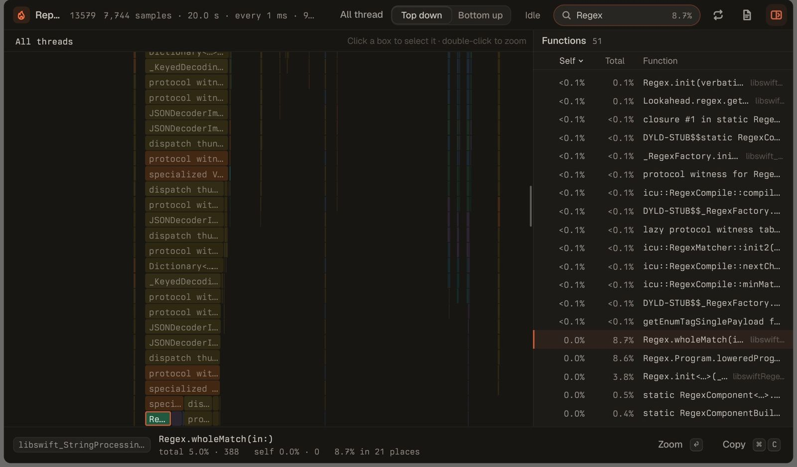
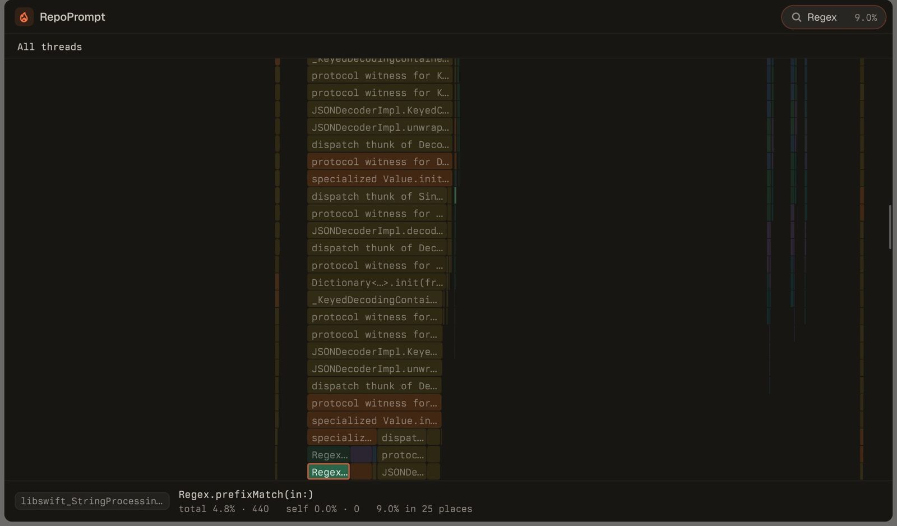
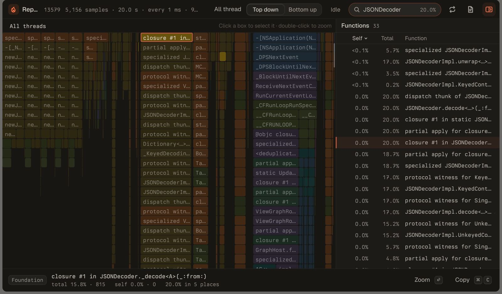
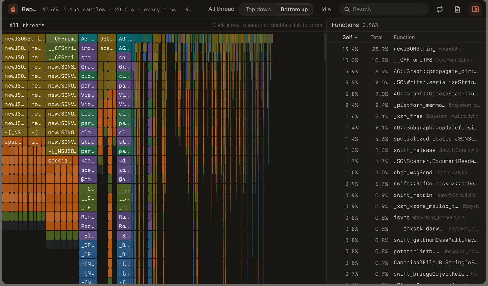
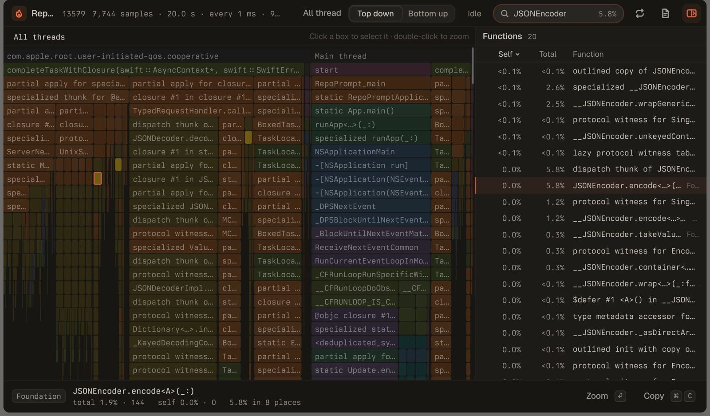

- Regex share: 5.0% (388 samples) in a, 4.8% (440) in f, 3.5% (182) in d.
- d (about 1 MB responses): `newJSONString` is **23.9% total**, `__CFFromUTF8` is **10.2% self**, and `JSONDecoder` is 15.8% (815).
- `JSONEncoder.encode` ranges from 0.9% (134 samples) in b to 3.6% (329) in f.

**Root cause.**
- The vendored swift-sdk encodes the typed result, then decodes it as `Value` (`Messages.swift:~197`). `Data.dataURLRegex` is a computed `static var`, so it builds a new `Regex` for every string (`Data+Extensions.swift`). This is about 18 to 25 ms CPU per call in the earlier `sample`.
- Every JSON-RPC frame is parsed 4 to 6 times (`UnixSocketMCPTransport.swift:198, 283-345, 398, 418, 880`, plus the response ledger and delivery tracker).

**Fix.** Make the regex a `static let` or drop the data-URL probe. Parse each frame once into an envelope and share it. Avoid the encode/decode round trip.

### 2.7 AttributeGraph storm on tool calls (confirmed; cause not attributed)

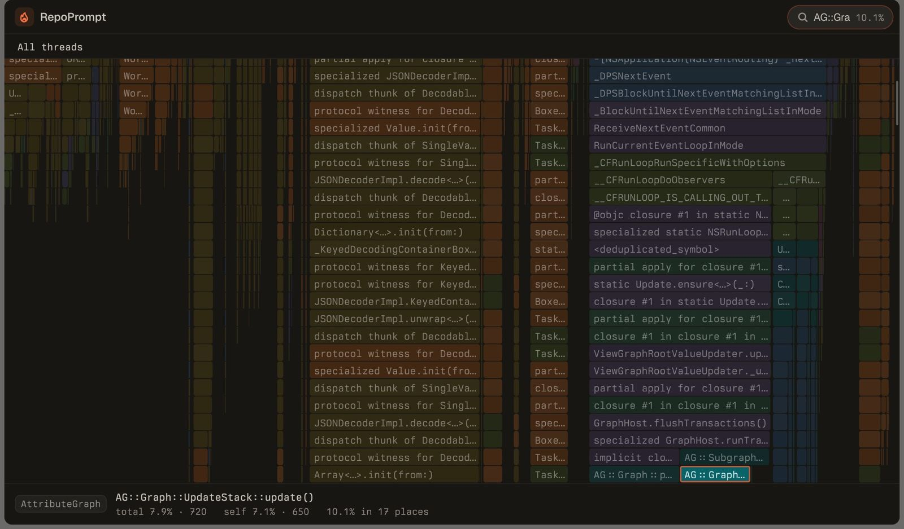
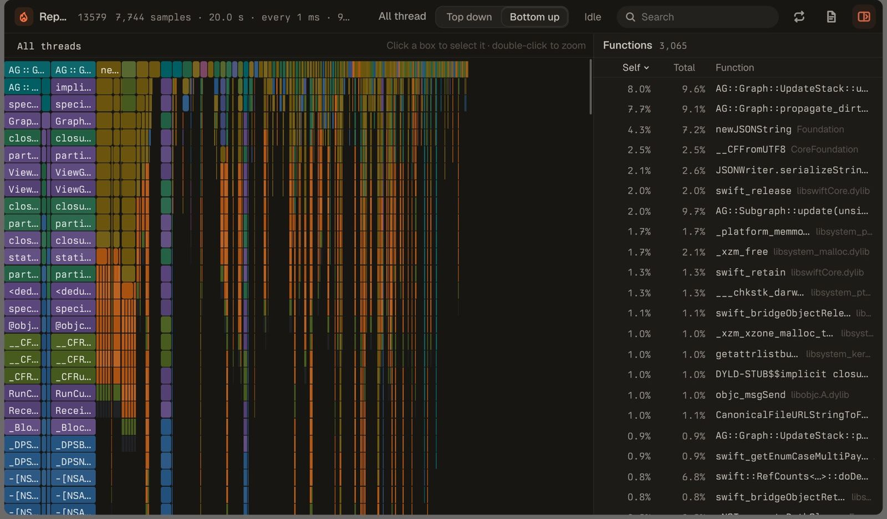
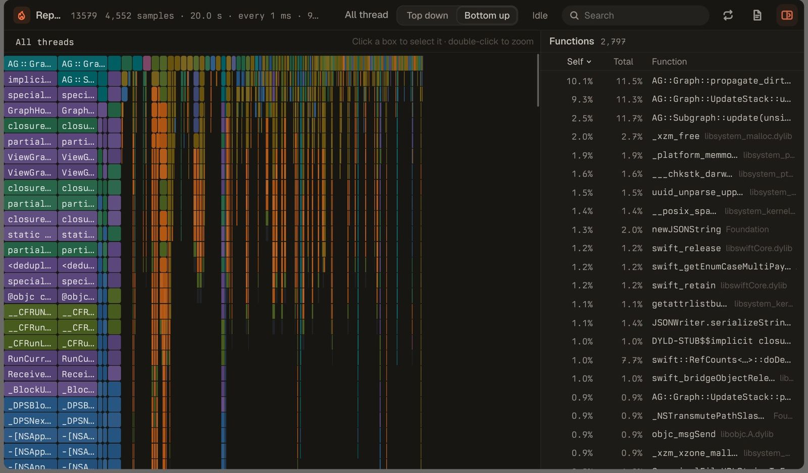

During MCP load, `AG::Graph::UpdateStack::update` and `propagate_dirty` are top self frames in a, e', f and g (and `propagate_dirty` in d):

| Scenario | `UpdateStack::update` self | `propagate_dirty` self |
|---|---|---|
| a | 8.0% | 7.7% |
| d | not in top 4 | 5.9% |
| e' | 6.2% | 6.6% |
| g | 9.3% | 10.1% |
| f | 7.1% (650 samples, Main-thread column) | n/a |

The idle profile had only 312 non-idle samples in total. This is a main-thread SwiftUI re-render triggered by tool traffic.

**Candidate causes, not measured.**
- Dashboard counters (`MCPServerViewModel.startDashboardUpdatesIfNeeded`).
- `enqueueVirtualTokenRefresh` publishing results per call.
- `AgentModeViewModel.refreshDerivedTranscriptState`.
- Connection-list `@Published` updates per connect and disconnect.

**Not done.** Tern's flame graph shows no app view-body frames beneath AG, so the view was not identified. Identification needs Instruments SwiftUI or Time Profiler with symbols.

### 2.8 Routing state, events monitor, process polling (confirmed, small)

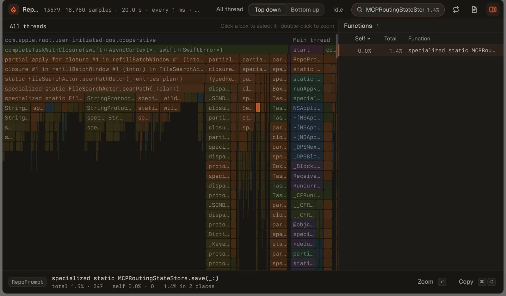
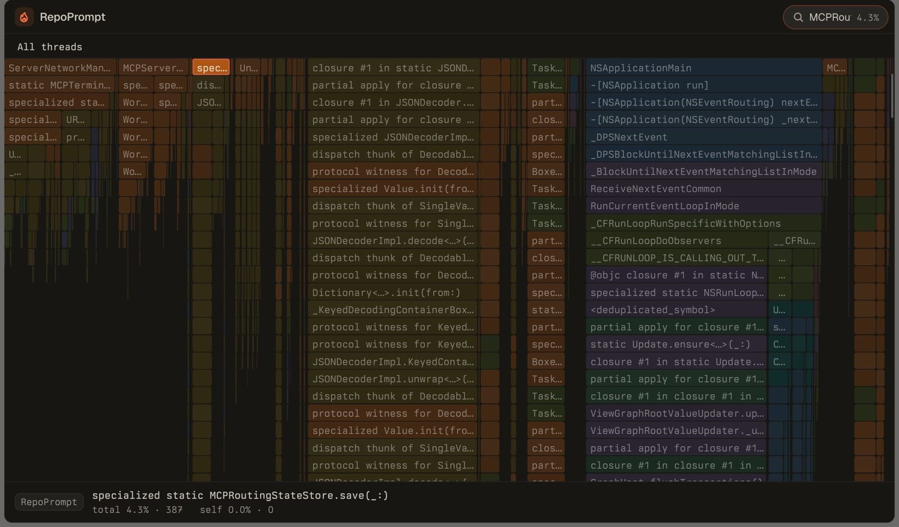
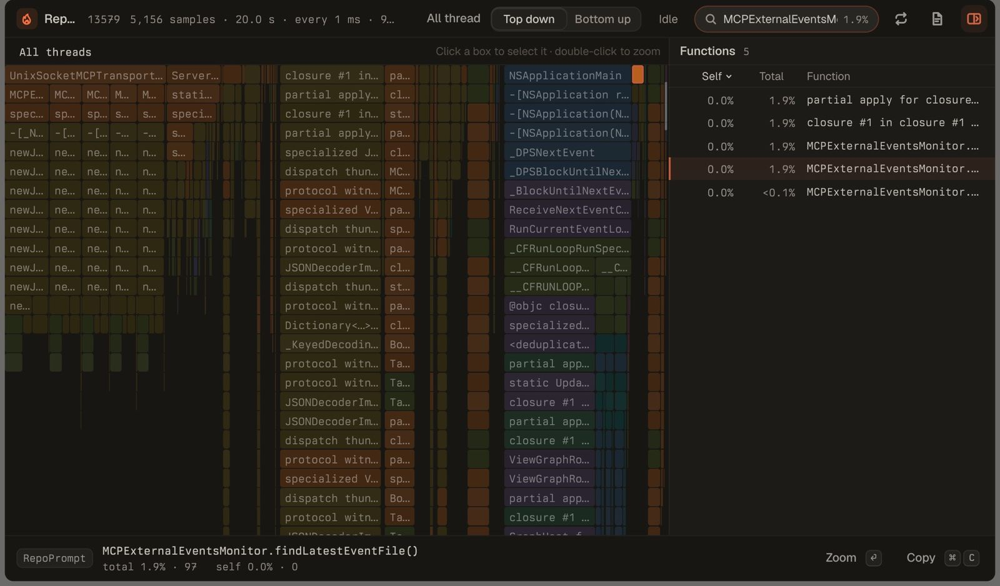
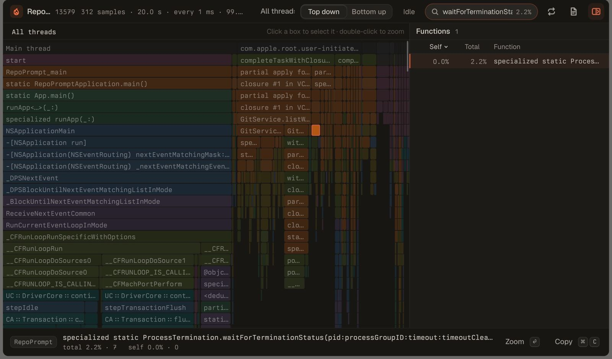

- `MCPRoutingStateStore.save` rewrites the whole pretty-printed `mcp-routing.json` (about 154 KB) on every connection. Its cost is real: 1.3% in c and 4.3% in f.
- The **8.3 s outlier in c and the 11.5 s outlier in d from the first run did not recur.** The maximum call latency in this run was 0.925 s, apart from item 1. The earlier run had swap at 7.9 of 9 GB. The stalls were most likely paging or contention. [INFERENCE: not proven.]
- `ProcessTermination.waitForTerminationStatus` is 2.2% idle (7 samples). Each live ACP child is polled via `waitpid(WNOHANG)` plus `Task.sleep` every 200 ms (`ProcessTermination.swift:275-277, 729-800`; `ACPAgentSessionController.swift:1912`). Codex already uses the event-driven path; the fix is to route ACP and CLI through it.

### 2.9 Git under load is cheap (confirmed)

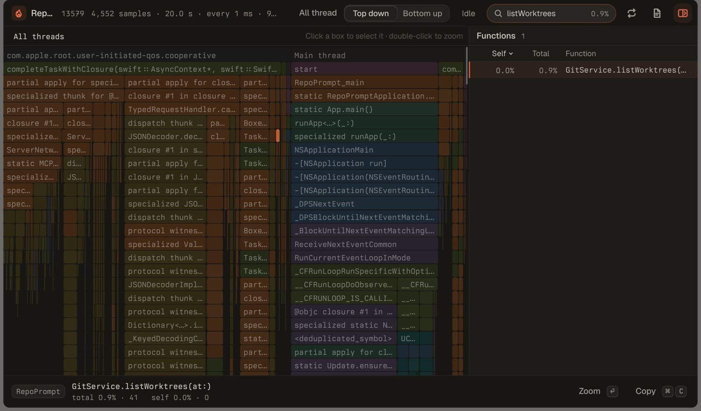
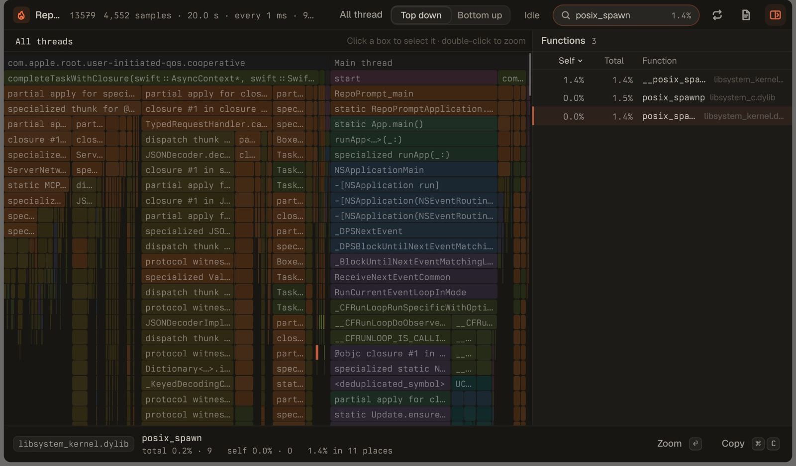
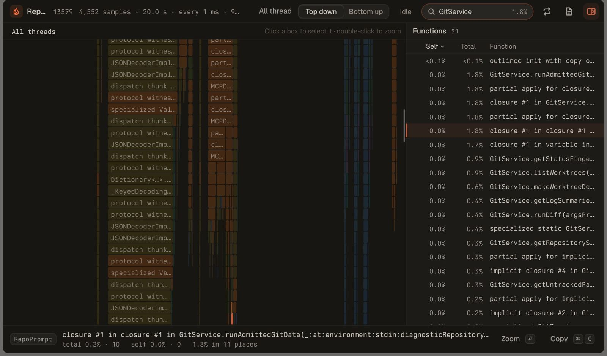

`listWorktrees` is 0.9% (41), `posix_spawn` 0.2% (9), `parseGitDate` 0.1% (6), and the 51 functions matching `GitService` total 0.2% (10 samples). The earlier claim that the codemap manifest writer dominated g (8,262 samples, `scanLocked`, `__openat`) was **not reproduced** here. It showed up only in e. Treat that claim as unverified until re-run with a `CodeMapRootManifestStore` probe in g.

## 3. Root-cause summary

| Rank | Root cause | Evidence |
|---|---|---|
| 1 | The demand-wait budget for code-structure signatures is a fixed 10 s, a static constant with no early exit. | 10.7 to 11.2 s vs 0.19 s without signatures. |
| 2 | The content-search line index is rebuilt for every file on every search. | 29.5% self in b. |
| 3 | Idle polling loops: a 2.5 s git worktree loop whose TTL equals its interval (so it never hits), a 5 s status fan-out, and 200 ms `waitpid` polling. | 18.3% `listWorktrees`, 7.4% spawn, 2.2% wait polling in idle. |
| 4 | SwiftUI invalidation: git `@Published` fan-out per poll, plus main-thread AG updates per MCP call. | Idle `NSHostingView.layout` 11.2%; AG self 5.8 to 10.1% under load. |
| 5 | MCP transport overhead: encode/decode/`Value` round trip, a `Regex` per string, 4 to 6 frame parses per request. | Regex 3.5 to 5.0%, `newJSONString` 23.9% total in d. |
| 6 | Path search allocation churn. | Retain/release 25.6% self in c. |
| 7 | Per-connection persistence: `MCPRoutingStateStore.save` and the terminal-record directory sort/prune. | 1.3 to 4.3%. The prune was not probed in Tern. |

## 4. Environment and confounds

- Swap was 7.9 of 9 GB at the time of the first load run. The system was under memory pressure. This likely inflated the earlier multi-second stalls.
- Other agents were active in the app during parts of the runs (Agent Mode transcripts, `ApplyEditsService`).
- Build variant: the idle `sample` report called it a debug build (exclusivity checks, retain/release inflated), while the load report treated `/Applications/RepoPrompt CE.app` as the release variant. **Unresolved.** If it is debug, self-time shares of retain/release and `objc_msgSend` are inflated.
- Tern shares are over non-idle samples of all threads. Do not compare them directly with the earlier `sample` percentages, which used per-thread time.

## 5. Memory (not Tern-verifiable)

Data came from `footprint`, `heap` and `vmmap`. Raw dumps were in `/tmp/rpce-prof/mem/` and are not copied into this folder. The full table is in `subreports/MemoryFootprintAnalysis.md`.

| Metric | Value |
|---|---|
| Footprint | 678 MB, peak 802 MB, later 702 to 744 MB |
| RSS | 243 to 456 MB, about 440 MB of MALLOC_SMALL swapped or compressed |
| Live malloc | 537 MB rising to 600 MB, then flat 598 MB for 3 idle minutes |
| Share of footprint that is the default malloc zone | about 90% |

Ranked consumers:
1. About 94,198 decoded code-map manifest records, each with its own un-interned `CodeMapArtifactKey` and `CodeMapPipelineIdentity`. About 130 to 170 MB (`CodeMapRootManifestModels.swift:545-565`, `CodeMapArtifactKey.swift:77-83, 119-120, 531-548`). The decoded-manifest LRU budgets encoded size, not decoded size (`CodeMapRootManifestStore.swift:83-124, 2551-2567`).
2. About 72 MB of large strings. The owner is not identified.
3. `DomainRoutingOutcome` retention: 4,096 operations, each embedding a full snapshot of every connection binding (`DomainRoutingCoordinator.swift:75-80, 188, 745-775`). The retained-snapshot arrays grew 39 to 668 in about 4 minutes. [INFERENCE: connections registered through `bind_context` may never be released.]

Growth is bursty and activity-driven. It was not a steady leak while idle.

## 6. Unverified backend findings (static review only)

No Tern run exercised these. Details and line references are in `subreports/SourceBackendHotPaths.md` and `subreports/SourceMainThreadAndUI.md`.
- Agent transcript mutators copy the whole items array and run a full duplicate-ID repair per streamed delta (`AgentTabSession.swift:2540, 2569, 2595, 2638`; `AgentTranscriptServices.swift:2206`). This is O(n²) over a long session.
- FSEvents directory removal and rename scan the whole `visitedPaths` set (`FileSystemService+FSEvents.swift:1742, 1803, 1905`).
- `WorkspaceFileContextStore.swift:8887-8896` builds four shard-sized dictionaries before the cap check at `:8973`.
- Worktree codemap demands read, hash and decode whole files before any cache lookup (`WorkspaceCodemapBindingEngine.swift:4512`).
- Claude NDJSON lines are parsed, re-encoded and re-parsed per stdout line (`ClaudeNativeProcessSessionController.swift:1501`).
- A streaming-transcript test is needed: run an Agent Mode session, record with Tern, and probe `AgentTabSession`.

## 7. What is proven and what is not

- **Proven in Tern:** items 1, 2, 4, 6 to 12 and 14 in section 1, including the numbers above.
- **Weak:** the tips-view attribution (item 5).
- **Not reproduced:** the 8.3 s and 11.5 s call stalls (item 13) and the g manifest-writer dominance (item 15).
- **Not Tern-verifiable:** memory (item 17).
- **Unverified static findings:** item 18.

## 8. Reproduction

1. Start a Tern window with a control socket from a writable directory: `cd /tmp/rpce-prof && tern --control /tmp/rpce-tern.sock`. The app's own `tern ctl shot` fails with a read-only filesystem error because it writes `target/shots/tern/live` relative to its cwd. `screencapture` also fails ("could not create image from display") in this environment.
2. `tern ctl --control /tmp/rpce-tern.sock procs open`, then `procs filter RepoPrompt`, `procs select RepoPrompt`, `profile record`.
3. Drive load with `~/Library/Application Support/RepoPrompt CE/repoprompt_ce_cli -w 3 -c <tool> -j <json>`. The debug CLI cannot reach this app's socket.
4. Probe with `profile find <text>`, `profile pick <text>`, `profile select <text>`, `profile invert on|off`, then `tern ctl shot <name>`.
5. Tern quirks: `zoom`, and `profile *` while zoomed, can hang the ctl reply. The harness in `data/harness.py` reads `tern ctl state` to check zoom and sets a 15 s timeout.
6. Load driver and scenario definitions: `data/drive.py`. Evidence harness: `data/harness.py`.
